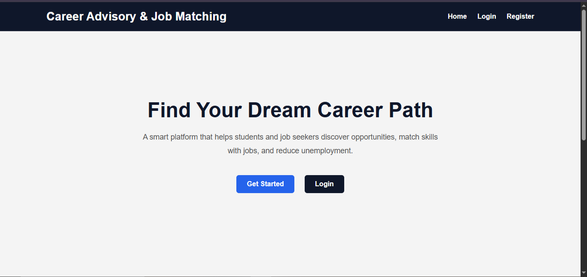
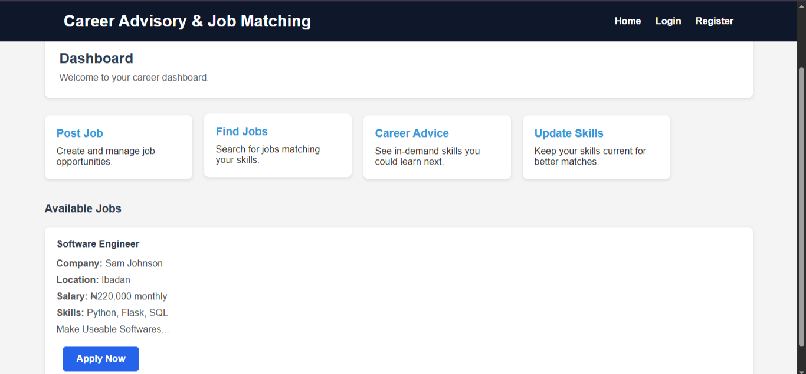
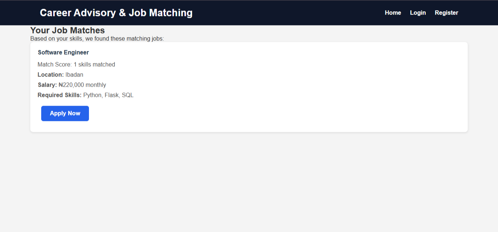
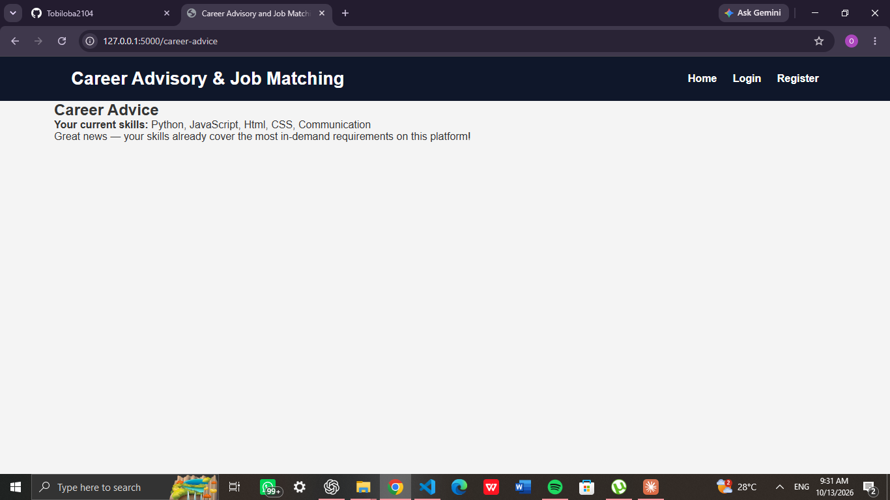

# Career Advisory and Job Matching System

A web platform that connects job seekers and employers. Employers post jobs with the skills they need, job seekers list their own skills, and the system matches them and shows which in-demand skills they could learn next. Built with Python, Flask and SQLite as a final year project.

## Screenshots

### Home Page


### Dashboard


### Job Matches


### Career Advice


## Features

- **Registration and login** for two account types: job seekers and employers. Passwords are stored as secure hashes.
- **Employers** can post jobs with a title, description, required skills, location and salary.
- **Job seekers** can update their skills, education and experience, and apply for jobs.
- **Skill-based job matching.** Jobs are ranked by how many of the job seeker's skills match the skills the job requires.
- **Career advice.** The system counts which skills appear most often across all job postings and recommends the most in-demand skills the user does not have yet.
- **Application tracking.** Each application is saved with a status, and a job seeker cannot apply to the same job twice.

## Technologies Used

| Technology | Purpose |
|------------|---------|
| Python | Backend logic |
| Flask | Web framework and routing |
| Flask-SQLAlchemy | Database models and queries |
| SQLite | Database |
| Jinja2 | Template rendering |
| HTML, CSS, JavaScript | Frontend |

## Project Structure

```
career-advisory-job-matching-system/
├── app.py
├── requirements.txt
├── templates/
│   ├── base.html
│   ├── index.html
│   ├── register.html
│   ├── login.html
│   ├── dashboard.html
│   ├── post_job.html
│   ├── update_skills.html
│   ├── matches.html
│   ├── career_advice.html
│   └── apply_job.html
├── static/
│   ├── style.css
│   └── script.js
├── screenshots/
└── README.md
```

The SQLite database is created automatically in an `instance` folder the first time the app runs.

## Getting Started

### Prerequisites
- Python 3 installed.
- Git installed.

### 1. Clone the Repository

```
git clone https://github.com/Tobiloba2104/career-advisory-job-matching-system.git
cd career-advisory-job-matching-system
```

### 2. Create a Virtual Environment

```
py -m venv venv
venv\Scripts\activate
```

### 3. Install the Requirements

```
py -m pip install -r requirements.txt
```

### 4. Run the Application

```
py app.py
```

Open the local address shown in the terminal in your browser.

### Optional: set your own secret key

For anything beyond local testing, set a long random secret key before running. On Windows PowerShell:

```
$env:SECRET_KEY="your-long-random-string"
```

## How to Try It

1. Register one **Employer** account and log in. Post a job and list the required skills separated by commas, for example `Python, HTML, SQL`.
2. Log out, then register a **Job Seeker** account and log in.
3. Click **Update Skills** and add your skills, for example `python, html`.
4. Click **Find Jobs** to see your matches, then apply for a job.
5. Click **Career Advice** to see in-demand skills you could learn next.

## Known Limitations and Future Improvements

- Save the cover letter submitted with each application.
- Let employers view and manage the applications they receive.
- Add CSRF protection to forms.
- Show Logout in the menu when a user is signed in.
- Add search and filtering for jobs.

## Developer

**Adebesin Oluwatobiloba**
Final-year Computer Science student | Python Developer | Aspiring Backend Developer
